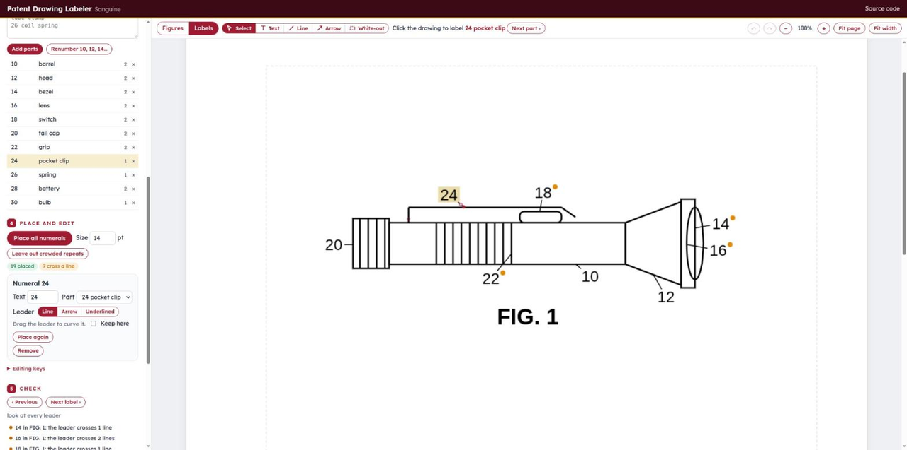

# Patent Drawing Labeler (Sanguine)

*Why Sanguine? The red chalk that Leonardo and Michelangelo drew with.*

**Runs on** any web browser: nothing to install, and the drawing never leaves your computer
(unless you choose *Ask Claude*, which sends the sheet images to Anthropic with your own key).

**Version 2.0.**

Part of [Veered](https://veered.org): free tools, shared as-is. Questions: support@veered.org

**Use it now: [veered.org/patent-drawing-labeler/app/](https://veered.org/patent-drawing-labeler/app/)**
(also at [patentlawny.com/patent-tools/label/](https://patentlawny.com/patent-tools/label/)).

Open a patent drawing, list the parts, and click each part once on the drawing. The
labeler puts the reference numeral in clear paper beside the figure and draws the
leader line. It picks a spot where the line is short, crosses as little of the
drawing as possible, and doesn't run into another numeral or leader. Then you fix
anything you like right on the page: drag numerals, curve leaders, switch a leader
to an arrow or an underlined numeral, add text, lines and arrows, and white out old
marks. You get a labeled PDF, an editable PowerPoint and the reference numeral list.

You don't have to do the clicking yourself. Claude can look at the drawing, name
and number the parts, and say where each one is: press *Ask Claude* (with an
Anthropic API key), or paste its answer from claude.ai. The labels are placed the
same way.

*The sample drawing. Claude chose these numerals and points; the labeler placed them.
The small orange dots mark leaders that had to cross one line of the drawing.*

> **A drafting aid, not a draftsman.** Check every leader against the part it names
> before you file (<kbd>[</kbd> and <kbd>]</kbd> step through them). Also check the
> drawings against 37 CFR 1.84 as it stands when you file. Nothing is sent to the
> Patent Office.

## What it does

- **Finds the figures.** It separates each view on a sheet, and keeps the loose parts
  of an exploded view with their figure. You can join, split or redraw them by
  dragging boxes. It spots "FIG. 3" captions already on the drawing, keeps them
  instead of adding a second one, and numbers the figures the way the captions do
  (FIG. 4a, 4b…) when it can read them. You can keep the sheets as drawn, or put each figure on its own
  Letter or A4 sheet, enlarged to fill it, with sheet numbers ("1/7").
- **Places the numerals.** For each part you click, it tries hundreds of positions
  and picks the best one. The best spot is clear of the drawing, inside the 37 CFR
  1.84(g) margins, close to the part, and outside the figure's outline, with a
  leader that crosses as few lines as it can and runs near no other part's tip.
  Then it shuffles the hardest labels until all of them fit together.
  A leader that would have to cross a line may bend gently round it instead (untick
  *Curve leaders round lines* for straight leaders only).
- **Lets you edit everything on the page:**
  - drag a numeral, a "FIG." label, a text or a line; drag the dot at the end of a
    leader to move its tip. A numeral you move stays where you put it the next time
    you place everything.
  - drag a leader to **curve** it (double-click it to straighten it again).
  - make a leader an **arrow** (37 CFR 1.84(r)), or drop it for an **underlined
    numeral** that sits on the surface it names (1.84(q)).
  - double-click a numeral, a "FIG." label or a text to change it; typing another
    part's numeral moves the label to that part.
  - add **text** (such as "PRIOR ART"), **lines** and **arrows**, and **white out**
    parts of the original drawing (old numerals, stray marks). White-out also frees
    that space for numerals.
  - select several things with <kbd>Shift</kbd>-click or by dragging a box, nudge
    them with the arrow keys, undo and redo as far back as you like.
  - <kbd>Shift</kbd>-click marks other spots on the same part that a leader may point
    to (a spring can be pointed at on any coil). **Leave out crowded repeats** drops
    a numeral from a figure where its leader would cross two or more lines, when
    another figure already shows it cleanly.
- **Keeps the numbering straight.** You type the parts with or without numerals.
  **Renumber** assigns 10, 12, 14… in list order and updates every label;
  *… around the figures* numbers them the way draftsmen do, by the figure a part
  first shows in and clockwise round that figure.
  Suffixes like 26a and 26b tell identical parts apart. The **Check** list flags
  numerals with no room, leaders that cross lines, a numeral used for two parts,
  duplicate figure numbers and parts not shown anywhere.
- **Keeps your work.** Everything is saved in your browser as you go, so a reload
  picks up where you left off. **Save work** writes one file with the drawing and
  the labels in it, to open later or hand to someone else. **Editable PDF** is a
  labeled PDF with that editing data inside: open it in the labeler again and every
  numeral, leader and note can be changed. (File the plain Labeled PDF.)
- **Writes the files:**
  - a **labeled PDF**. The original drawing stays vector, and the font is embedded
    (Patent Center rejects fonts that aren't embedded).
  - an **editable PowerPoint**. The drawing is a picture, and each numeral, leader,
    text and line is its own shape.
  - the **reference numeral list**: a Word table with Numeral, Element and "Shown
    in" (FIGS. 1–3 and 5) columns, plus plain-text and CSV copies.

## How you use it

1. **Open the drawing:** a PDF, or a PNG or JPEG scan.
2. **Check the figures** in the *Figures* view. Choose whether to keep the sheets
   as drawn or give each figure its own sheet.
3. **Find the parts:** press *Ask Claude*, or list the parts, one per line, press
   *Add parts*, pick a part in the list and **click it on the drawing**: once in
   each figure where it shows, on a line of the part. <kbd>Tab</kbd> moves to the
   next part.
4. Press **Place all numerals** to re-place everything together, then **edit**
   anything you don't like on the page.
5. **Check:** step through every label with <kbd>]</kbd>, and look at the Check list.
6. **Download** the PDF, the PowerPoint and the parts list.

### Letting Claude do the clicking

**With an API key** (from [console.anthropic.com](https://console.anthropic.com/settings/keys)):
press **Ask Claude**, paste the key, and send. The page sends the sheet images and
your parts list straight to Anthropic's API (nothing passes through this site), and
the run is billed to your Anthropic account. The key is kept in your browser only if
you tick *Remember*.

**Without one,** use [claude.ai](https://claude.ai) (free accounts work):

1. Press **Download the sheet images**. It saves each sheet as a picture with a
   percent grid, so Claude can read positions off it.
2. Press **Copy the prompt**. The prompt already lists the figures found and any
   parts you have typed.
3. In Claude, attach the images, paste the prompt and send it.
4. Copy Claude's whole reply, press **Paste Claude's answer**, and import it.

Either way, each point is snapped to the nearest line and the labels are placed.
**Check every leader.** Claude reads positions off a picture and will sometimes pick
the wrong line. Drag the tip to fix it.

The sample drawing (*Try it on a sample drawing*) shows the whole round trip:
[examples/flashlight-claude.json](examples/flashlight-claude.json) is the answer
Claude gave for [examples/flashlight.pdf](examples/flashlight.pdf).

## Information for nerds

It is one static page (`index.html`, `app.js`, `engine.js`, `fonts/`) with no build
step and no server. Serve the folder with any web server, for example
`python3 -m http.server`, and open it. It loads pdf.js, pdf-lib, fontkit and JSZip
from cdnjs/jsDelivr, PptxGenJS only when you ask for a PowerPoint, and the
Anthropic SDK only when you press *Ask Claude*. Work in progress is kept in
IndexedDB; a saved project is JSON with the drawing in base64, and an editable PDF
carries the same JSON as an embedded file named `sanguine-project.json`.

Leaders are straight or quadratic curves (one control point). Labels, text and lines
are anchored to their figure in source-page points, so they follow it when the
layout changes; white-outs belong to a source page and are painted onto the sheet
before the ink mask is taken, so placement treats the space as clear.

**The placement engine** (`engine.js`, no dependencies, runs in the browser and in
Node) works on the sheet rendered at 144 dpi:

- a dilated ink mask, so it can tell whether a leader touches a line;
- summed-area tables, for a constant-time "is this box clear?" test;
- the figure's filled silhouette, so numerals prefer the outside.

For each tip it scores numeral positions at 5° steps and a range of distances:
`600 × lines crossed + 4 × ink under the leader + 0.25 × length (steeper past about
55 pt) + an outward-direction term + 600 inside the outline` (1000 in a snug spot
inside it). A leader that would cross a line also tries four gentle bends (quadratic
curves) and keeps any that cross fewer lines. It then places the labels greedily, hardest
first (the ones with the fewest cheap spots). The unplaced labels move to the front
and it tries again, and five repair passes re-pick each label against all the
others. Candidates are rejected when numerals come within 16 px of each other,
when leaders cross or pass within 20 px, or when a leader clips a numeral. The
constants were tuned at 200 dpi and scale with the render.

Coordinates in Claude's answer are percent of the sheet as shown (fractions are
accepted too). Label points are snapped to the nearest ink within about 12 pt, and
each figure box is shrunk to the ink inside it. *Ask Claude* uses structured output
(a JSON schema), so the answer always parses.

**Tests:** `node tests/engine.test.js` builds a synthetic drawing and checks that
the numerals land on clear paper inside the margins, that no two collide, that the
leaders don't cross, and that the figure finder separates the drawings.

`examples/make_flashlight.py` redraws the sample drawing (needs `reportlab`).

The label font is Liberation Sans (SIL Open Font License 1.1, see
`fonts/LICENSE-LiberationSans.txt`). It has Helvetica's metrics and can be embedded.

## License

MIT. See [LICENSE](LICENSE). The bundled Liberation Sans font is under the SIL Open
Font License 1.1. Written with AI assistance (Claude).
